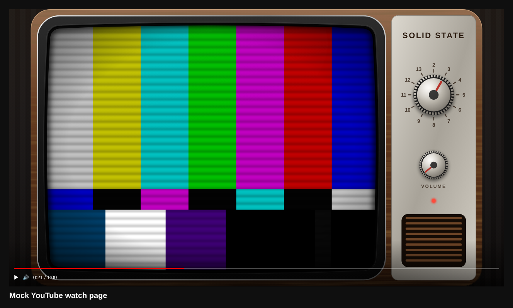
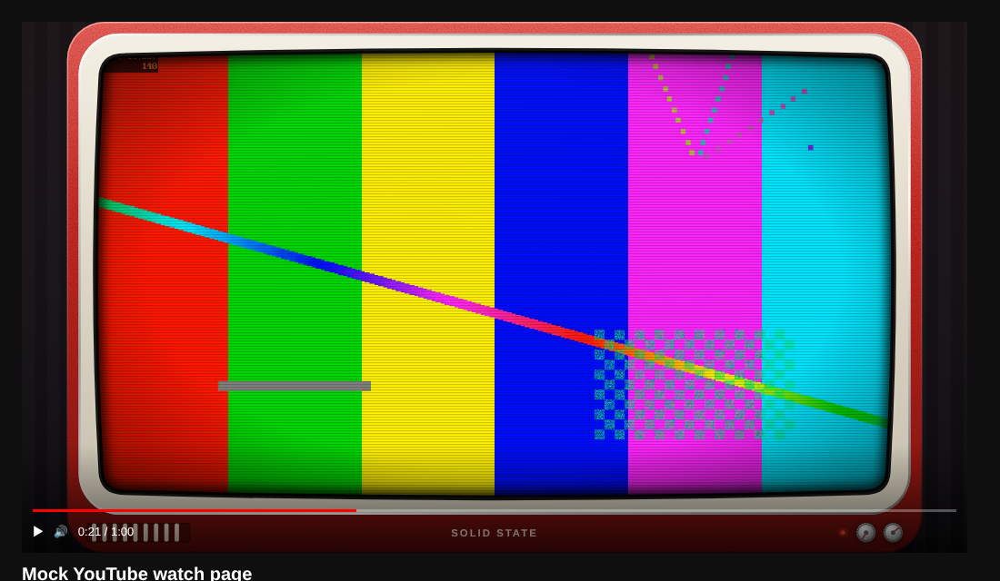
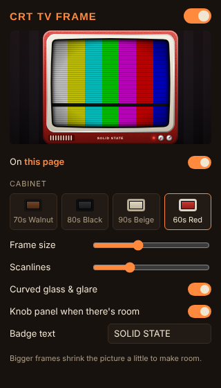

# CRT TV Frame

A browser extension that frames YouTube videos, and most other videos on the web, in an old television set instead of plain black bars.

- **4:3 videos** (old shows, music videos) get a full 70s-style set: wood cabinet, chrome trim, and a side panel with a channel dial, volume knob, power light and speaker grille.
- **Widescreen videos** get a slimmer bezel with the knobs and badge in the "chin" below the screen.
- The tube has rounded "pillow" corners, light scanlines and curved-glass glare (both adjustable).
- If the TV doesn't fill the player, the space around it is a dim wall instead of black bars. Rabbit-ear antennas show up when there's room above.
- The power light is on while the video plays.





## Install (Chrome, Edge, Brave, Opera, Arc)

1. Download or clone this repository somewhere you'll keep it.
2. Go to `chrome://extensions` (or `edge://extensions`).
3. Turn on **Developer mode** (top right).
4. Click **Load unpacked** and pick the folder (the one that contains `manifest.json`).
5. Open a YouTube video. Pin the extension icon to get to its settings.

## Settings (click the toolbar icon)



| Setting | What it does |
| --- | --- |
| Master switch | Turns the frame on or off everywhere |
| On this site | Turns it off for just the current site |
| Cabinet | 70s Walnut, 80s Black, 90s Beige, 60s Red |
| Frame size | Thicker or thinner bezel |
| Scanlines | 0 = off |
| Curved glass & glare | Edge vignette and reflection on the tube |
| Knob panel | Use the side panel with dials when there's room |
| Badge text | The label on the set (default "SOLID STATE") |

Changes apply right away to open tabs.

## How it works

The content script finds every `<video>` and measures where the picture actually sits (it handles `object-fit` and players like YouTube that size the video element themselves). It then draws the TV as an SVG over the player. The SVG is see-through only where the screen is, and lets clicks pass through. If there's no black-bar space to put the frame in, it shrinks the picture slightly with CSS `scale`/`translate` so the frame doesn't cover any of the video. Turning the extension off puts everything back.

## Limitations

- If a site puts the bare `<video>` element itself into fullscreen, browsers don't let anything draw on top of it, so you won't see the frame there. YouTube, Vimeo, Twitch and most players fullscreen their whole player, so it works on those.
- Videos smaller than 280×150 (thumbnails, hover previews) and muted looping background videos are skipped.
- A frame needs room, so a 16:9 video in a 16:9 player shrinks a bit. Use **Frame size** to pick how much.

## Firefox

Add this to `manifest.json`, then load it from `about:debugging` → *This Firefox* → *Load Temporary Add-on*:

```json
"browser_specific_settings": { "gecko": { "id": "crt-tv-frame@example.com" } }
```
